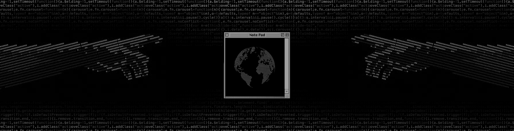

  

<h1 align="center">Olá! Sou o Gidelmar Júnior</h1>
<h3 align="center">Desenvolvedor Full Stack & Engenheiro de Software</h3>

  Focado em construir aplicações eficientes, escaláveis e orientadas a dados. Aqui você encontrará projetos voltados para Desenvolvimento Web, APIs, Bancos de Dados e cibersegurança.

---

## 🔍 Sobre mim

- 🌱 Desenvolvedor Full Stack com sólida atuação em React, Next.js, JavaScript, Node.js, Java e bancos de dados relacionais (PostgreSQL, MySQL).
- 🎓 Estudante de Engenharia de Software no UNICEPLAC e entusiasta de Segurança da Informação.
- 🚀 Constantemente em busca de aprendizado, aplicando boas práticas de código, arquitetura limpa e desenvolvimento eficiente.

---

## 🎯 Objetivo Profissional

> Consolidar minha carreira atuando no desenvolvimento de software de alta performance, unindo uma base sólida em engenharia full-stack com a minha especialização contínua em Cibersegurança e AppSec, para projetar sistemas seguros desde a concepção.

---
  
## 📱 Redes sociais e Contato

  
  &nbsp;&nbsp;
  
  &nbsp;&nbsp;
  

## 🛠️ Tecnologias e Habilidades

### 01. Front-End
*Linguagens, frameworks e bibliotecas de interface*

  
  
  
  
  
  
  
  

 

### 02. Back-End
*Ambientes de execução, frameworks e arquitetura de APIs*

  
  
  
  

 

### 03. Banco de Dados
*SGBDs e ORMs*

  
  
  
  
  

 

### 04. DevOps e Ferramentas
*Desenvolvimento, colaboração e deploy*

  
  
  
  
  
  
  

 

### 05. Cibersegurança e Redes
*Análise de vulnerabilidades, testes e segurança defensiva*

  
  
  
  
  

## 🏆 Projetos em Destaque

- **[Financeday](https://financeday.vercel.app/)**: Painel de câmbio global em tempo real com leitura analítica por IA, desenvolvida com React e Node.js.
  - 🛠️ **Tecnologias:**   

- **[Yummy](https://yummy-one-phi.vercel.app/)**: Plataforma completa de gestão e operação para restaurantes, desenvolvida com React, Node.js, Python e PostgreSQL.
  - 🛠️ **Tecnologias:**   

- **[Minhas Financias](https://minhas-financias-navy.vercel.app/)**: Um sistema web completo e moderno de gestão financeira pessoal, projetado para o controle detalhado de despesas. Desenvolvida com React, Node.js, JavaScript e PostgreSQL.
  - 🛠️ **Tecnologias:**   

- **[G.JR Portfólio](https://gidelmarjr.vercel.app)**: Aplicação web de apresentação pessoal e profissional focada em engenharia de software e segurança.
  - 🛠️ **Tecnologias:**   

## 🏆 Estatísticas

 

  

 
